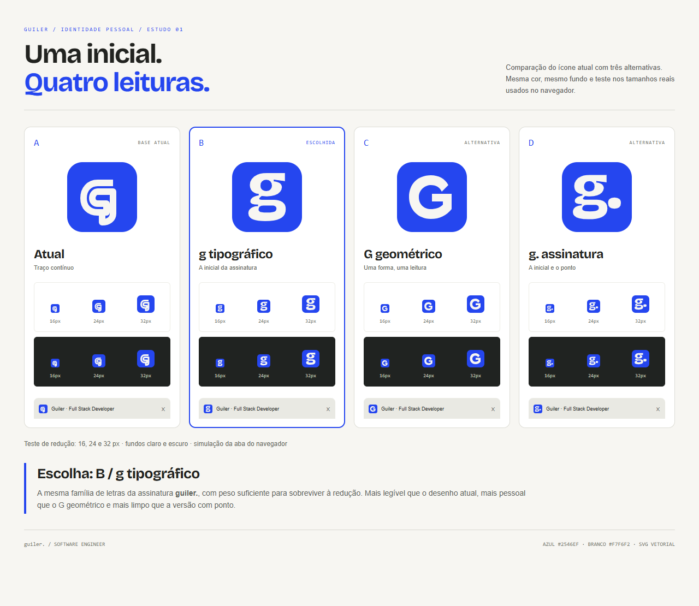

# Guiler — estudo do ícone

## Escolha: B — g tipográfico

A inicial usa o mesmo desenho de letra da assinatura `guiler.`, em Bricolage Grotesque com peso 800. O contorno foi convertido em SVG: o ícone não depende de instalar ou carregar a fonte.

| Versão | Leitura em 16 px | Relação com a marca | Decisão |
| --- | --- | --- | --- |
| A — atual | Os encontros internos tornam a inicial ambígua. | Mantém o traço tecnológico original. | Referência para comparação. |
| B — g tipográfico | As duas contraformas continuam visíveis. | Compartilha a letra da assinatura `guiler.`. | Melhor equilíbrio entre legibilidade e identidade. |
| C — G geométrico | A letra é imediatamente reconhecível. | Mais genérico; menos próximo da assinatura. | Alternativa se a prioridade for apenas leitura imediata. |
| D — g. assinatura | O ponto ocupa espaço e reduz o tamanho da inicial. | Retoma também o ponto da assinatura. | Funciona melhor ampliado do que como favicon. |

Comparação visual realizada em 16, 24 e 32 px, com fundos claro e escuro e uma simulação da aba do navegador. Um segundo revisor também selecionou B.

## Arquivos

- `guiler-mark.svg`: versão escolhida com fundo azul, indicada para favicon e avatar.
- `guiler-mark-512.png`: exportação PNG de 512 × 512 px.
- `guiler-symbol-blue.svg`: símbolo azul sem fundo.
- `guiler-symbol-white.svg`: símbolo claro sem fundo, para superfícies escuras.
- `a-original.svg`, `b-g-tipografico.svg`, `c-g-geometrico.svg`, `d-g-assinatura.svg`: as quatro versões comparadas.
- `comparacao.html`: comparação navegável; os arquivos SVG precisam estar na mesma pasta.
- `comparacao.png`: prancha completa, pronta para compartilhar.

Paleta: azul `#2546ef` e branco `#f7f6f2`. Manter a proporção quadrada, sem esticar a letra. Para favicons, usar a versão com fundo a partir de 16 px. O símbolo sem fundo conserva o respiro interno do quadrado de 64 × 64.

As alternativas tipográficas derivam da Bricolage Grotesque já usada no projeto; o desenho da letra está convertido em contornos. A seleção está entregue como estudo e arquivos próprios nesta pasta; a referência original está preservada em `public/favicon.svg`.
